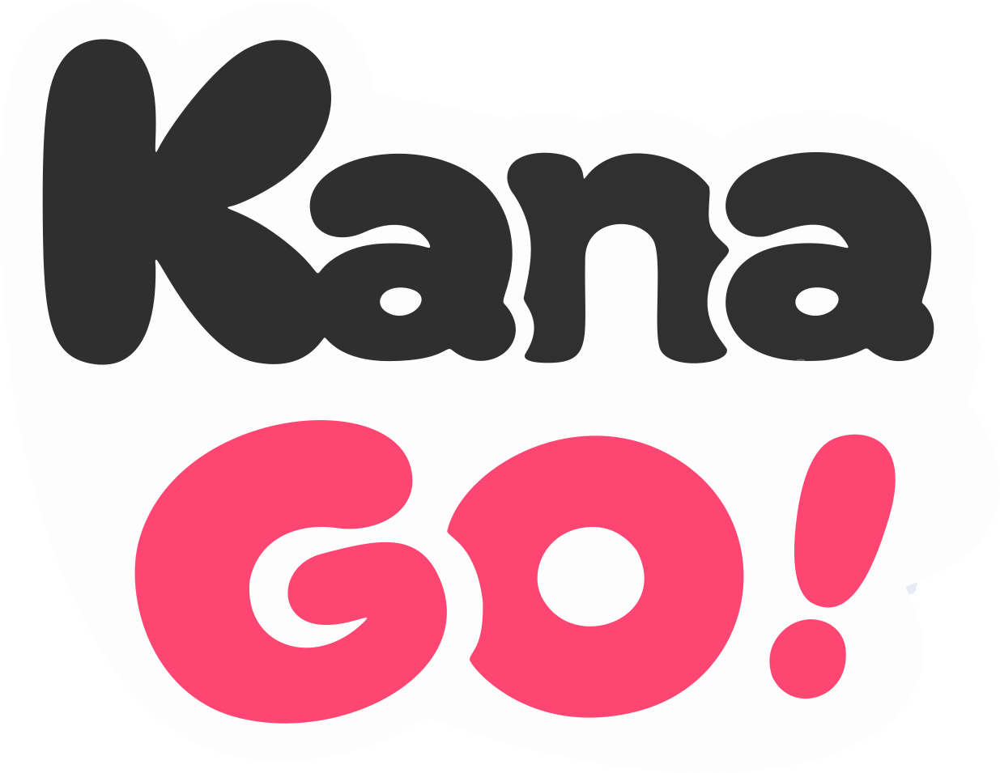

# KanaGO!



**Japonés de la あ al N1, a tu ritmo.**

KanaGO! es una app nativa para iPhone, hecha con SwiftUI. Combina lecciones cortas, repaso espaciado y práctica de japonés con Kana-chan, la mascota que te acompaña durante el aprendizaje.

Sin cuentas ni anuncios. El progreso se guarda en tu iPhone y la interfaz está disponible en español e inglés.

## Ramas y repositorio

La app y la web se versionan en [Manuekle/kanago](https://github.com/Manuekle/kanago), con dos checkouts locales y ramas separadas:

| Rama | Contenido | Directorio local |
| --- | --- | --- |
| **`ios`** | App nativa, proyecto Xcode, widgets, contenido, audio y recursos. | Raíz de este proyecto. |
| **`web`** | Sitio estático con despliegue automático a producción en Vercel. | `site/` |
| **`main`** | Versión de la web integrada mediante pull requests. | Repositorio de la web. |

Para subir commits de la app desde la raíz, usa `git push origin ios`. Para subir commits del sitio desde aquí, usa `git -C site push origin web`.

`site/`, las claves en `.env*`, los archivos de compilación y la configuración local de Xcode quedan fuera del Git de iOS. El archivo `app/vercel.json` de la rama `ios` desactiva sus despliegues en Vercel.

## Ejecutar la app

Necesitas macOS, Xcode 26 o posterior y un simulador o iPhone con iOS 17 o posterior.

1. Abre el proyecto:

   ```bash
   open KanaGO.xcodeproj
   ```

2. Selecciona el esquema **KanaGO** y un simulador de iPhone.
3. Ejecuta con **⌘R**.

Para usar un iPhone físico, configura tu equipo de desarrollo en **Signing & Capabilities** de los targets `KanaGO` y `KanaGOWidget`. Ambos deben compartir el mismo App Group, definido en sus archivos de entitlements y en `Shared/WidgetSnapshot.swift`.

Los datos, las voces pregrabadas y los efectos de sonido ya están incluidos. No necesitas una clave de ElevenLabs para ejecutar la app.

## Qué puedes hacer

| Sección | Funciones |
| --- | --- |
| **Inicio** | Racha, XP, meta diaria, repasos pendientes, siguiente lección, palabra e historia del día. |
| **Kana** | Hiragana y katakana con audio, búsqueda por romaji, práctica de trazo con corrección automática, palabras de ejemplo y quiz por filas. |
| **Aprender → Ruta** | Siete rutas: Kana, Viaje y N5–N1. Las lecciones se desbloquean de forma progresiva y repiten los errores para reforzar lo aprendido. |
| **Aprender → Mazos** | Vocabulario, kanji y gramática con tarjetas y repaso espaciado SM-2. |
| **Aprender → JLPT** | Práctica de vocabulario y gramática N5–N1, escucha en N5, temporizador y repaso de errores. |
| **Explorar** | Conversaciones de rol, historias graduadas y canciones con letra sincronizada, romaji, traducción y modo karaoke. |
| **Yo** | Estadísticas, vocabulario guardado, idioma, romaji, sonido, meta diaria, recordatorios y elección de voz. |

Los mazos ofrecen hasta siete modos de práctica: **Quiz**, **Escuchar**, **Pronunciar**, **Emparejar**, **Teclear**, **Construir frase** y **Escribir a mano**. Los modos disponibles dependen del contenido de cada mazo.

La escritura a mano se corrige sola. Al calcar, cada trazo se revisa al levantar el dedo: posición, dirección, forma y orden. Al escribir de memoria se revisa el carácter completo al tocar **Comprobar**, sin importar su tamaño ni dónde se dibuje en el lienzo. Si algo falla, Kana-chan dice qué trazo está mal y la app anima el orden correcto.

El simulacro JLPT combina 30 preguntas de vocabulario y gramática en 20 minutos. Un resultado de al menos 70 % desbloquea un certificado de práctica para compartir. Los simulacros y certificados no son oficiales.

### Contenido incluido

- **131 unidades y 641 lecciones** distribuidas en siete rutas.
- **50 mazos**, con 1.165 tarjetas y 186 entradas de gramática.
- **37 conversaciones**, **18 historias** y **19 canciones**.

## Widgets

La extensión `KanaGOWidget` incluye:

- **Racha:** widget pequeño y versiones circular y en línea para la pantalla bloqueada.
- **Palabra del día:** tamaños pequeño, mediano y rectangular para la pantalla bloqueada.
- **Hoy:** widget mediano con racha, actividad semanal y tarjetas por repasar.

La app comparte un resumen del progreso mediante `widget-snapshot.json` en el App Group. Los widgets leen ese archivo y muestran a Kana-chan según la actividad del día. Cuando hay tarjetas pendientes, tocar **Hoy** abre el repaso con `kanago://review`.

## Datos, audio y conexión

El contenido se carga desde `KanaGO/Resources/Data/`. El progreso se guarda en `Application Support/kanago-progress.json`, dentro del contenedor de la app.

Las lecciones, tarjetas, historias, simulacros y clips de voz incluidos funcionan sin conexión. Los videos de YouTube necesitan internet; sin video, puedes leer la letra y tocar cada línea para escucharla. **Pronunciar** y el modo karaoke necesitan permisos de micrófono y reconocimiento de voz, y dependen de la disponibilidad del reconocimiento de Apple.

Puedes elegir entre las voces **Yona** y **Kasane** en la pestaña **Yo**. Los clips pregrabados están en `KanaGO/Resources/Audio/`; cuando no hay un clip disponible, la app usa la síntesis de voz japonesa de iOS.

## Estructura del proyecto

```text
KanaGO.xcodeproj/        Proyecto de Xcode: app y extensión de widgets
KanaGO/
  App/                  Arranque, navegación y enlaces de los widgets
  Data/                 Modelos, progreso, repaso, audio y sincronización
  Design/               Colores, tipografía, componentes y Kana-chan
  Features/             Pantallas y sesiones de aprendizaje
  Assets.xcassets/       Logo, íconos, mascotas y stickers
  Resources/
    Data/               Contenido en JSON
    Audio/              Voces pregrabadas en M4A
    Sounds/             Efectos de la interfaz en WAV
KanaGOWidget/           Widgets de inicio y pantalla bloqueada
Shared/                 Modelo de datos compartido con los widgets
scripts/                Herramientas para generar audio, recursos y tiempos de canciones
design/                 Recursos y referencias de diseño
app/vercel.json         Desactiva los despliegues de Vercel de la rama ios
site/                   Copia local del sitio web, con repositorio propio
```

## Diseño

Los tokens viven en `KanaGO/Design/Theme.swift` (`KG`). La paleta sigue el tono de los widgets:

| Token | Color | Uso |
| --- | --- | --- |
| `KG.pink` | `#F23A7C` | Rellenos de marca; `KG.pinkGradient` replica el degradado de los widgets. |
| `KG.mint` | `#12A865` | Aciertos, metas cumplidas, unidad verde de la ruta. |
| `KG.sky` | `#1A8CF0` | Escucha, JLPT, unidad azul. |
| `KG.grape` | `#9B6BFF` | N2 y modo Construir frase. |
| `KG.pinkText`, `mintDeep`, `skyDeep` | — | Texto pequeño sobre fondos claros (≥ 4,5:1). |

Regla de contraste: el texto blanco sobre un relleno debe ser semibold o bold y llegar a 3:1 (criterio de Apple para texto en negrita). `KG.on(_:)` elige blanco o tinta según el relleno. El texto de peso regular sobre fondos claros usa las variantes `Text`/`Deep`.

El color del arranque (`LaunchBackground`) está en Display P3 con los valores equivalentes a `KG.pink`, para que la pantalla de arranque del sistema y la animación de `SplashView` coincidan. iOS guarda en caché la pantalla de arranque: tras cambiar ese color, reinicia el dispositivo o reinstala la app para verlo.

### Íconos

Los íconos son [Hugeicons](https://hugeicons.com) en contorno, convertidos a SVG de plantilla en `Assets.xcassets/Hugeicons`. Las versiones rellenas (`hi.<nombre>.fill`) se usan en estados activos (pestaña seleccionada, racha, XP).

1. Añade el ícono en el mapa de `scripts/hugeicons.js` y en el enum `HI` de `Theme.swift`.
2. Genera los contornos (necesita `@hugeicons/core-free-icons` en un `node_modules` junto al script):

   ```bash
   node scripts/hugeicons.js KanaGO/Assets.xcassets
   ```

3. Genera los rellenos (necesita `pip install skia-pathops picosvg`):

   ```bash
   python3 scripts/hugeicons_solid.py KanaGO/Assets.xcassets
   ```

El paso 2 borra la carpeta `Hugeicons`, así que ejecuta siempre el 3 después. Los rellenos se construyen con recetas en `hugeicons_solid.py`; el pincel de la pestaña Kana usa un SVG dibujado a mano (`scripts/brush.fill.svg`).

## Actualizar contenido y recursos

Los archivos de `KanaGO/Resources/Data/` contienen los mazos, el silabario, la ruta, las conversaciones, canciones, historias y preguntas JLPT. Después de modificar textos japoneses, puedes generar los clips de voz que falten.

### Voces pregrabadas

La generación requiere Python 3, `afconvert` de macOS y una clave de ElevenLabs. Configúrala como `ELEVENLABS_API_KEY` en el entorno o en `.env.local`, en la raíz del proyecto. Ese archivo está excluido de Git.

Primero revisa los clips pendientes sin generar audio ni llamar a ElevenLabs:

```bash
python3 scripts/generate_audio.py --dry-run
```

Para generar los clips de cada voz:

```bash
python3 scripts/generate_audio.py --voice yona
python3 scripts/generate_audio.py --voice kasane
```

El script también graba cada ficha del modo **Construir frase**. Para saber cómo se cortará cada frase compila `KanaGO/Data/SentenceChunks.swift` junto con `scripts/sentence_chunks.swift`, la misma lógica que usa la app. Los cortes que el tokenizador hace mal, sobre todo en frases solo en kana, se corrigen a mano en `KanaGO/Resources/Data/chunks.json`.

La generación usa créditos de ElevenLabs y omite los clips que ya existen. Puedes volver a ejecutar el comando para completar los pendientes.

### Tiempos de las canciones

Cada línea de `songs.json` lleva `time` (cuándo empieza la voz), `end` (cuándo termina) y `marks` (cuándo empieza cada frase separada por espacios, solo si la línea tiene más de una). El karaoke y la línea activa se iluminan con esos tiempos. Si una línea no tiene `end`, el relleno avanza a un ritmo estimado.

Los tiempos se miden contra el video de cada canción, no a oído. El script baja el audio, separa la voz y alinea el romaji de cada línea con ella. Necesita `ffmpeg`, `yt-dlp` y un entorno con PyTorch (la primera vez descarga unos 1,3 GB de modelos):

```bash
python3 -m venv build/lyrics-venv
build/lyrics-venv/bin/pip install torch torchaudio demucs soundfile
build/lyrics-venv/bin/python scripts/lyrics/align_lyrics.py ctc unravel
swift scripts/lyrics/lyric_marks.swift unravel
python3 scripts/lyrics/align_lyrics.py apply unravel
```

`lyric_marks.swift` imprime cada línea con su tiempo anterior y el nuevo. Escucha las marcadas con `SHIFT`, `GAP`, `LONG` o `LOW`. El alineador falla con samples de baja calidad o coros repetidos, como la intro de `kick-back`. Para esas líneas, vuelve a alinear dentro de un rango de segundos con `ctc <id> --window PRIMERA ÚLTIMA DESDE HASTA`, o ajusta los tiempos a mano en `songs.json`.

### Orden de trazos

`KanaGO/Resources/Data/strokes.json` guarda los trazos de cada carácter que la app pide escribir, sacados de [KanjiVG](https://kanjivg.tagaini.net) (CC BY-SA 3.0, con crédito en **Yo**). Si cambian los mazos o el silabario, descarga el XML del [último release](https://github.com/KanjiVG/kanjivg/releases) y regenera el archivo. El script avisa si falta algún carácter:

```bash
python3 scripts/build_strokes.py kanjivg-20260714.xml.gz
```

`KanaGO/Data/Strokes.swift` compara los trazos. Para ajustar sus umbrales, `scripts/stroke_harness.swift` simula escritura imprecisa, trazos invertidos o en otro orden, y kana parecidos, y mide cuántos acepta:

```bash
swiftc -O -parse-as-library KanaGO/Data/Strokes.swift scripts/stroke_harness.swift -o /tmp/strokes
cp KanaGO/Resources/Data/strokes.json /tmp/ && /tmp/strokes
```

### Efectos de sonido

Las recetas están en `scripts/sounds/patches.json` y el reproductor en `scripts/sounds/player.js`. Para regenerar los WAV necesitas Python 3 y Google Chrome instalado en macOS:

```bash
python3 scripts/sounds/render.py
```

## Sitio web

El sitio público es independiente de la app: HTML, CSS y JavaScript estáticos, con páginas de privacidad, términos, cookies y soporte. La carpeta `site/` contiene su repositorio local y está excluida del proyecto principal mediante `.gitignore`.

Para abrir la vista previa desde la raíz de KanaGO!:

```bash
python3 site/scripts/serve.py
```

Abre [localhost:4181](http://localhost:4181). El servidor reconoce las rutas sin extensión, como `/privacy` y `/support`.

Más detalles sobre la web, los recursos de marca y el botón del App Store están en [el README del sitio](site/README.md).

## Capturas de App Store

La serie v7 está en inglés, con capturas reales de la interfaz, titulares centrados, fondos pastel por función y mascotas que asoman por detrás del teléfono; Ruta tiene una pose más grande hacia la izquierda y JLPT una más grande y centrada. Conserva la isla dinámica del marco SVG y limpia la que el simulador incorpora en cada captura para evitar duplicarla.

Las doce imágenes RGB de subida están en `design/appstore/KanaGO-AppStore-en/`, en 1206 × 2622 y 1320 × 2868, y en `design/appstore/KanaGO-AppStore-en.zip`. [Las instrucciones](design/appstore/KanaGO-AppStore-en/README.md) incluyen el origen y la regeneración con `python3 scripts/appstore_assets.py`; [la dirección visual](design/appstore/KanaGO-AppStore-en/design.md) documenta el sistema. La carpeta conserva únicamente el ZIP actualizado y su contenido descomprimido.
